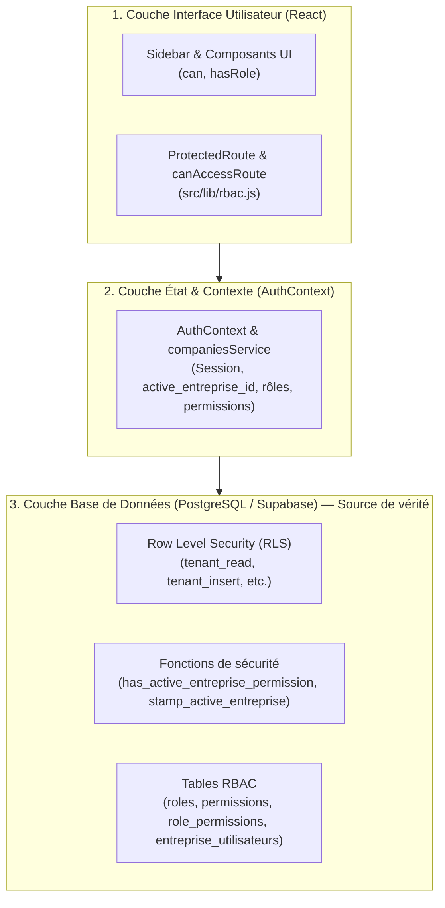
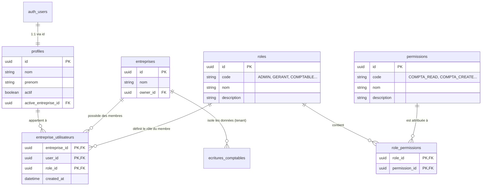

# Processus de Gestion des Droits et des Accès - CIPRESA

Ce document détaille l'architecture, le cycle de vie et le fonctionnement technique du système de gestion des droits (**Role-Based Access Control - RBAC**) et du cloisonnement multi-entreprises au sein de l'application **CIPRESA**.

---

## 1. Vue d'Ensemble de l'Architecture de Sécurité

La gestion des droits dans CIPRESA repose sur une **défense en profondeur à 3 niveaux** :



1. **Couche Base de Données (Source de Vérité Absolue)** : Même si un utilisateur tente de manipuler l'interface, les **Row Level Security (RLS)** de PostgreSQL et les triggers vérifient l'appartenance à l'entreprise active et les permissions requises.
2. **Couche Logique Applicative (`AuthContext`)** : Centralise la session, résout l'entreprise active et calcule la liste des permissions effectives de l'utilisateur.
3. **Couche Présentation (`ProtectedRoute` & Composants)** : Adapte la navigation, masque les éléments non autorisés et bloque l'accès aux pages non autorisées.

---

## 2. Modèle de Données RBAC & Multi-Entreprises

Le modèle sépare les rôles par **entreprise** : un utilisateur peut avoir le rôle de `COMPTABLE` dans une entreprise A et celui de `CONSULTANT` dans une entreprise B.

### 2.1. Schéma Relationnel



### 2.2. Les Tables Clés

- **`profiles`** : Extension du compte d'authentification (`auth.users`). Contient le statut de validité (`actif: boolean`) et l'entreprise actuellement active (`active_entreprise_id`).
- **`entreprises`** : Les entités juridiques gérées dans la plateforme.
- **`roles`** : Référentiel des rôles applicatifs (`ADMIN`, `GERANT`, `COMPTABLE`, `CONSULTANT`, `MAGASINIER`, `AGENT_COMMERCIAL`).
- **`permissions`** : Catalogue des droits unitaires (`COMPTA_READ`, `COMPTA_CREATE`, `CONFIG_USERS`, etc.).
- **`role_permissions`** : Association statique entre un rôle et l'ensemble des permissions qu'il accorde.
- **`entreprise_utilisateurs`** : Table de liaison triple (`entreprise_id`, `user_id`, `role_id`). Elle matérialise l'adhésion d'un utilisateur à une entreprise donnée avec un rôle spécifique.

---

## 3. Processus Opérationnel d'Attribution et de Modification des Droits

### Processus pas-à-pas :

```
[Administrateur]
   │
   ├─► 1. Accède à la page "Configuration" (/configuration)
   │
   ├─► 2. Saisit l'e-mail d'un utilisateur inscrit & choisit un rôle initial
   │      │
   │      ▼
   │   RPC `add_user_to_company(p_email, p_role_code, p_entreprise_id)`
   │      ├── Vérifie que l'exécutant est ADMIN (permission CONFIG_USERS)
   │      ├── Cherche l'utilisateur dans auth.users
   │      └── Insère l'association dans `entreprise_utilisateurs`
   │
   ├─► 3. Optionnel : Ajoute un rôle supplémentaire
   │      │
   │      ▼
   │   RPC `add_user_company_role(p_user_id, p_entreprise_id, p_role_code)`
   │
   ├─► 4. Optionnel : Retire un rôle
   │      │
   │      ▼
   │   RPC `remove_user_company_role(p_user_id, p_entreprise_id, p_role_id)`
   │      └── Trigger `prevent_last_company_admin` : empêche de supprimer le dernier ADMIN
   │
   └─► 5. Optionnel : Désactive un compte utilisateur (profiles.actif = false)
```

### 3.1. Règles Métier et Sécurités Intégrées
- **Seul un Administrateur peut gérer les droits** : La procédure SQL `add_user_to_company` et les tables associées vérifient impérativement `public.has_active_entreprise_permission('CONFIG_USERS')`.
- **Garde-fou du dernier administrateur** : Un déclencheur de sécurité PostgreSQL (`prevent_last_company_admin`) interdit la suppression ou la modification du rôle `ADMIN` s'il est le dernier administrateur de l'entreprise, évitant ainsi tout blocage irréversible du compte entreprise.
- **Compte utilisateur préalable** : Pour être rattaché à une entreprise, le destinataire doit avoir préalablement créé son compte (table `auth.users`).

---

## 4. Résolution des Droits au Runtime (Frontend)

Le chargement et la mise à disposition des droits s'effectuent de façon dynamique dans [`src/context/AuthContext.jsx`](file:///home/arthur/Documents/Projet_en_cour/compaCipresa/src/context/AuthContext.jsx).

### 4.1. Séquence d'Initialisation à la Connexion

1. **Récupération de session** : Supabase Auth valide le jeton JWT.
2. **Lecture du profil & des adhésions** :
   ```javascript
   const [profileResult, membershipsResult] = await Promise.all([
     supabase.from("profiles").select("*").eq("id", session.user.id).single(),
     companiesService.listMemberships(session.user.id),
   ]);
   ```
3. **Détermination de l'entreprise active** :
   - L'application lit `profile.active_entreprise_id`.
   - Si l'ID est valide et présent parmi ses adhésions, il est conservé.
   - Sinon, la première entreprise disponible devient l'entreprise active par défaut.
4. **Extraction des rôles actifs** :
   - Les adhésions sont filtrées sur `entreprise_id === active_entreprise_id`.
   - Les rôles correspondants sont stockés dans le state `roles`.
5. **Résolution des permissions** :
   - Une requête charge toutes les lignes de `role_permissions` liées aux rôles de l'utilisateur.
   - Les codes de permission uniques sont regroupés dans le tableau `permissions`.

### 4.2. Changement d'Entreprise (`switchEntreprise`)
Lorsque l'utilisateur change d'entreprise active via la barre supérieure :
1. Appel de la fonction SQL `switch_active_entreprise(id)` qui met à jour `profiles.active_entreprise_id`.
2. Rechargement immédiat des rôles de l'utilisateur propres à la nouvelle entreprise.
3. Recalcul instantané du tableau `permissions` dans le contexte React.
4. Les interfaces et gardes de routes se réévaluent automatiquement sans rechargement complet de la page.

### 4.3. Fonctions Utilitaires Fournies par `useAuth()`
- **`hasRole(roleCode)`** : Renvoie `true` si l'utilisateur possède le rôle spécifié dans l'entreprise active (ex: `hasRole('ADMIN')`).
- **`can(permissionCode)`** : Renvoie `true` si l'utilisateur possède cette permission (ex: `can('COMPTA_READ')`, `can('COMPTA_CREATE')`).

---

## 5. Protection des Routes et des Vues

La sécurité de la navigation est assurée par [`src/routes/ProtectedRoute.jsx`](file:///home/arthur/Documents/Projet_en_cour/compaCipresa/src/routes/ProtectedRoute.jsx) et le catalogue de règles dans [`src/lib/rbac.js`](file:///home/arthur/Documents/Projet_en_cour/compaCipresa/src/lib/rbac.js).

### 5.1. Matrice des Droits par Route (`ROUTE_PERMISSIONS`)

```javascript
export const ROUTE_PERMISSIONS = {
  dashboard:     ['COMPTA_READ', 'SALES_READ'],
  chart:         ['COMPTA_READ'],
  journal:       ['COMPTA_READ'],
  ledger:        ['COMPTA_READ'],
  reports:       ['COMPTA_READ'],
  treasury:      ['COMPTA_READ'],
  inventory:     ['COMPTA_READ', 'STOCK_INVENTORY'],
  assets:        ['COMPTA_READ', 'STOCK_INVENTORY'],
  sales:         ['SALES_READ', 'COMPTA_READ'],
  closures:      ['COMPTA_READ'],
  settings:      ['CONFIG_COMPANY', 'COMPTA_READ'],
  users:         ['CONFIG_USERS'],
  analytics:     ['PLATFORM_ADMIN'],
  profile:       [],
  help:          [],
  createEntry:   ['COMPTA_CREATE'],
  createAccount: ['COMPTA_CREATE', 'COMPTA_ACCOUNT_CREATE'],
  createAsset:   ['COMPTA_ASSET_EDIT'],
  createClosure: ['COMPTA_CLOTURE_PREPARE'],
};
```

### 5.2. Fonctionnement de `ProtectedRoute`

Lorsqu'un utilisateur tente d'accéder à une route :
1. **Contrôle d'authentification** : Redirection vers `/connexion` si aucune session active.
2. **Contrôle d'activation du compte** : Si `profile.actif === false`, affichage de l'écran rouge « Compte désactivé ».
3. **Contrôle d'adhésion** : Si `companies.length === 0`, affichage de l'écran « En attente de rattachement à une entreprise ».
4. **Contrôle d'attribution de rôle** : Si l'utilisateur n'a aucun rôle dans l'entreprise sélectionnée, accès bloqué.
5. **Contrôle granulaire (`canAccessRoute`)** : Si la route nécessite des permissions précises et que l'utilisateur ne les possède pas, redirection automatique vers `/dashboard` ou `/profil`.

---

## 6. Sécurité en Base de Données (Row Level Security - RLS)

Les règles de sécurité RLS empêchent toute fuite de données entre entreprises et interdisent les actions non autorisées, même en cas de requête SQL directe.

### 6.1. Fonctions de Sécurité Définies (PostgreSQL)

- **`current_entreprise_id()`** : Retourne l'identifiant de l'entreprise active du profil appelant (`auth.uid()`).
- **`is_entreprise_member(p_id)`** : Vérifie que l'utilisateur connecté est un membre actif de cette entreprise.
- **`has_active_entreprise_permission(p_code)`** :
  ```sql
  SELECT EXISTS (
    SELECT 1 FROM public.entreprise_utilisateurs eu
    JOIN public.roles r ON r.id = eu.role_id
    LEFT JOIN public.role_permissions rp ON rp.role_id = r.id
    LEFT JOIN public.permissions p ON p.id = rp.permission_id
    WHERE eu.user_id = auth.uid()
      AND eu.entreprise_id = public.current_entreprise_id()
      AND (r.code = 'ADMIN' OR p.code = p_code)
  );
  ```
  *(Remarque : Le rôle `ADMIN` hérite automatiquement de toutes les permissions).*
- **`stamp_active_entreprise()`** : Trigger automatique exécuté `BEFORE INSERT OR UPDATE` sur les tables comptables (écritures, comptes, journaux, etc.). Il affecte obligatoirement l'identifiant `entreprise_id = current_entreprise_id()` et empêche un utilisateur d'écrire dans une autre entreprise.

### 6.2. Politiques RLS Standards sur les Tables Comptables

Pour chaque table isolée par entreprise (`ecritures_comptables`, `lignes_ecritures`, `journaux`, etc.) :

| Opération SQL | Nom de la Politique | Condition de Validation (Check / Using) |
| :--- | :--- | :--- |
| **SELECT** | `tenant_read` | `is_entreprise_member(entreprise_id) AND can_read_active_accounting()` |
| **INSERT** | `tenant_insert` | `is_entreprise_member(entreprise_id) AND can_write_active_accounting()` |
| **UPDATE** | `tenant_update` | `is_entreprise_member(entreprise_id) AND can_write_active_accounting()` |
| **DELETE** | `tenant_delete` | `is_entreprise_member(entreprise_id) AND can_write_active_accounting()` |

*(Pour les tables spécifiques comme `clotures_comptables` ou `exercices_comptables`, les droits de suppression ou de validation requièrent `COMPTA_CLOTURE` ou `CONFIG_COMPANY`).*

---

## 7. Guide Pratique pour les Évolutions Futures

### Comment ajouter une nouvelle fonctionnalité sécurisée ?

1. **Si une nouvelle permission est requise** :
   - L'insérer dans la table `public.permissions` via une migration SQL.
   - Associer la permission aux rôles concernés dans `public.role_permissions`.
2. **Associer la permission à une route dans le frontend** :
   - Déclarer la route et sa permission dans `src/lib/rbac.js` (`ROUTE_PERMISSIONS`).
   - Englober la route dans `AppRoutes.jsx` avec `<ProtectedRoute access={ROUTE_PERMISSIONS.votreFeature}>`.
3. **Conditionner l'affichage des boutons dans les composants** :
   ```jsx
   const { can, hasRole } = useAuth();

   {can('MA_NOUVELLE_PERMISSION') && (
     <Button onClick={handleAction}>Action Spécifique</Button>
   )}
   ```
4. **Appliquer la politique RLS en base de données** :
   - Ajouter un contrôle avec `public.has_active_entreprise_permission('MA_NOUVELLE_PERMISSION')` dans la politique de la table concernée.

