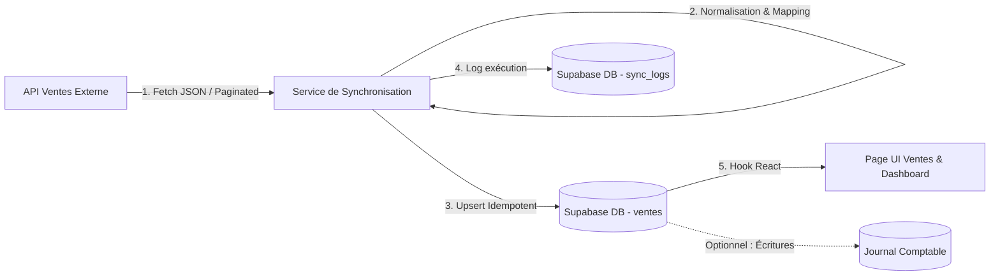

# Guide d'Implémentation : Module de Synchronisation des Ventes

Ce document décrit pas à pas la conception et la mise en œuvre d'un module complet de **synchronisation des ventes** entre une API externe (logiciel de caisse, CRM, ERP ou e-commerce) et notre application **Cipresa Accounting** (React + Supabase).

---

## 1. Vue d'ensemble de l'architecture



### Principes clés
1. **Idempotence** : Réexécuter la synchronisation plusieurs fois ne doit pas créer de doublons (utilisation d'un identifiant unique externe `external_id` et de `upsert`).
2. **Tolérance aux pannes** : Traitement par lots (batches), journalisation détaillée de chaque tentative (succès, échecs, volume).
3. **Réactivité de l'interface** : Retour visuel immédiat dans l'application avec indicateur de chargement, toasts de statut et mise à jour en temps réel.

---

## 2. Structure de la Base de Données (Supabase)

Exécutez ce script SQL dans le **SQL Editor** de Supabase pour créer les tables nécessaires.

```sql
-- 1. Table d'historique des synchronisations
CREATE TABLE IF NOT EXISTS sync_logs (
    id UUID PRIMARY KEY DEFAULT gen_random_uuid(),
    source VARCHAR(50) NOT NULL DEFAULT 'VENTES_API',
    statut VARCHAR(20) NOT NULL CHECK (statut IN ('EN_COURS', 'SUCCES', 'ERREUR', 'PARTIEL')),
    total_recupere INT DEFAULT 0,
    total_insere INT DEFAULT 0,
    total_mis_a_jour INT DEFAULT 0,
    message_erreur TEXT,
    started_at TIMESTAMPTZ DEFAULT now(),
    finished_at TIMESTAMPTZ
);

-- 2. Table des ventes synchronisées
CREATE TABLE IF NOT EXISTS ventes (
    id UUID PRIMARY KEY DEFAULT gen_random_uuid(),
    external_id VARCHAR(100) UNIQUE NOT NULL,      -- ID unique dans l'API source
    reference_facture VARCHAR(100),
    client_nom VARCHAR(255),
    client_identifiant VARCHAR(100),
    date_vente TIMESTAMPTZ NOT NULL,
    montant_ht NUMERIC(15, 2) NOT NULL DEFAULT 0,
    montant_tva NUMERIC(15, 2) NOT NULL DEFAULT 0,
    montant_ttc NUMERIC(15, 2) NOT NULL DEFAULT 0,
    mode_reglement VARCHAR(50) DEFAULT 'ESPECES',
    statut_comptable VARCHAR(30) DEFAULT 'A_COMPTABILISER' 
        CHECK (statut_comptable IN ('A_COMPTABILISER', 'COMPTABILISE', 'IGNORE')),
    donnees_brutes JSONB,                          -- Sauvegarde de la charge utile d'origine
    created_at TIMESTAMPTZ DEFAULT now(),
    updated_at TIMESTAMPTZ DEFAULT now()
);

-- Index pour optimiser les requêtes
CREATE INDEX IF NOT EXISTS idx_ventes_date ON ventes(date_vente DESC);
CREATE INDEX IF NOT EXISTS idx_ventes_external_id ON ventes(external_id);
CREATE INDEX IF NOT EXISTS idx_ventes_statut ON ventes(statut_comptable);
```

---

## 3. Configuration des Variables d'Environnement

Ajoutez les accès de l'API externe dans votre fichier `.env` :

```env
# API Ventes de l'entreprise
VITE_SALES_API_URL=https://api.votre-entreprise.com/v1
VITE_SALES_API_KEY=votre_cle_api_secrete
```

---

## 4. Implémentation du Service de Synchronisation

Créez le fichier `src/services/syncVentesService.js` :

```javascript
import { supabase } from "../lib/supabaseClient";

const SALES_API_URL = import.meta.env.VITE_SALES_API_URL;
const SALES_API_KEY = import.meta.env.VITE_SALES_API_KEY;

/**
 * 1. Récupère les ventes depuis l'API distante avec gestion de période
 */
export async function fetchExternalSales({ dateDebut, dateFin, page = 1, limit = 100 } = {}) {
  const url = new URL(`${SALES_API_URL}/ventes`);
  if (dateDebut) url.searchParams.append("date_from", dateDebut);
  if (dateFin) url.searchParams.append("date_to", dateFin);
  url.searchParams.append("page", page);
  url.searchParams.append("limit", limit);

  const response = await fetch(url.toString(), {
    headers: {
      Authorization: `Bearer ${SALES_API_KEY}`,
      "Content-Type": "application/json",
      Accept: "application/json",
    },
  });

  if (!response.ok) {
    const errorBody = await response.text();
    throw new Error(`Erreur API Ventes (${response.status}): ${errorBody}`);
  }

  return await response.json();
}

/**
 * 2. Mappe les données externes vers le format interne Supabase
 */
export function mapExternalSaleToLocal(item) {
  const ht = Number(item.total_ht || item.amount_ht || 0);
  const tva = Number(item.total_tva || item.tax_amount || 0);
  const ttc = Number(item.total_ttc || item.total_amount || (ht + tva));

  return {
    external_id: String(item.id || item.sale_id),
    reference_facture: item.invoice_number || item.code || `FAC-${item.id}`,
    client_nom: item.customer_name || item.client?.nom || "Client Divers",
    client_identifiant: item.customer_code || item.client?.id || null,
    date_vente: new Date(item.created_at || item.date).toISOString(),
    montant_ht: ht,
    montant_tva: tva,
    montant_ttc: ttc,
    mode_reglement: item.payment_method || "ESPECES",
    donnees_brutes: item,
    updated_at: new Date().toISOString(),
  };
}

/**
 * 3. Lance le pipeline de synchronisation complet avec journalisation
 */
export async function syncSalesPipeline({ dateDebut, dateFin } = {}) {
  // A. Créer un log d'entrée
  const { data: logEntry, error: logErr } = await supabase
    .from("sync_logs")
    .insert([{ statut: "EN_COURS", source: "VENTES_API", started_at: new Date().toISOString() }])
    .select()
    .single();

  if (logErr) throw logErr;

  try {
    // B. Récupération des données distantes
    const externalData = await fetchExternalSales({ dateDebut, dateFin });
    const items = Array.isArray(externalData) ? externalData : (externalData.data || []);

    if (items.length === 0) {
      await supabase.from("sync_logs").update({
        statut: "SUCCES",
        total_recupere: 0,
        finished_at: new Date().toISOString(),
      }).eq("id", logEntry.id);

      return { count: 0, message: "Aucune nouvelle vente à synchroniser." };
    }

    // C. Transformation et normalisation
    const records = items.map(mapExternalSaleToLocal);

    // D. Upsert dans Supabase (idempotence via external_id)
    const { data: upserted, error: upsertErr } = await supabase
      .from("ventes")
      .upsert(records, {
        onConflict: "external_id",
        ignoreDuplicates: false, // Met à jour si déjà existant
      })
      .select();

    if (upsertErr) throw upsertErr;

    // E. Clôture du log de synchro avec succès
    await supabase.from("sync_logs").update({
      statut: "SUCCES",
      total_recupere: items.length,
      total_insere: upserted?.length || items.length,
      finished_at: new Date().toISOString(),
    }).eq("id", logEntry.id);

    return {
      success: true,
      count: upserted?.length || items.length,
      logId: logEntry.id,
    };
  } catch (error) {
    // F. Journalisation de l'erreur
    await supabase.from("sync_logs").update({
      statut: "ERREUR",
      message_erreur: error.message,
      finished_at: new Date().toISOString(),
    }).eq("id", logEntry.id);

    throw error;
  }
}
```

---

## 5. Modèle de Données `Vente`

Dans `src/models/Vente.js`, utilisez le `BaseModel` du projet :

```javascript
import BaseModel from "./BaseModel";

export class Vente extends BaseModel {
  static table = "ventes";
  static ordering = { column: "date_vente", ascending: false };
  static fields = {
    id: { type: "uuid", readOnly: true },
    external_id: { type: "text", required: true },
    reference_facture: { type: "text" },
    client_nom: { type: "text" },
    client_identifiant: { type: "text" },
    date_vente: { type: "date", required: true },
    montant_ht: { type: "number", default: 0 },
    montant_tva: { type: "number", default: 0 },
    montant_ttc: { type: "number", default: 0 },
    mode_reglement: { type: "text", default: "ESPECES" },
    statut_comptable: { type: "text", default: "A_COMPTABILISER" },
  };

  static async getVentesRecentes(limit = 50) {
    return this.all({ limit, orderBy: "date_vente", ascending: false });
  }

  static async getEnAttenteComptabilisation() {
    return this.filter({ statut_comptable: "A_COMPTABILISER" });
  }
}
```

---

## 6. Hook React personnalisé : `useSyncVentes`

Créez le fichier `src/hooks/useSyncVentes.js` pour piloter l'état et la synchronisation depuis n'importe quel composant :

```javascript
import { useState, useEffect, useCallback } from "react";
import { supabase } from "../lib/supabaseClient";
import { syncSalesPipeline } from "../services/syncVentesService";

export function useSyncVentes() {
  const [ventes, setVentes] = useState([]);
  const [lastLog, setLastLog] = useState(null);
  const [loading, setLoading] = useState(true);
  const [syncing, setSyncing] = useState(false);
  const [error, setError] = useState(null);

  // Charger les ventes depuis Supabase
  const loadData = useCallback(async () => {
    try {
      setLoading(true);
      setError(null);

      const [ventesRes, logsRes] = await Promise.all([
        supabase
          .from("ventes")
          .select("*")
          .order("date_vente", { ascending: false })
          .limit(100),
        supabase
          .from("sync_logs")
          .select("*")
          .order("started_at", { ascending: false })
          .limit(1)
          .maybeSingle(),
      ]);

      if (ventesRes.error) throw ventesRes.error;
      setVentes(ventesRes.data || []);
      setLastLog(logsRes.data || null);
    } catch (err) {
      setError(err.message);
    } finally {
      setLoading(false);
    }
  }, []);

  useEffect(() => {
    loadData();
  }, [loadData]);

  // Déclencher la synchronisation manuelle
  const triggerSync = async (params = {}) => {
    try {
      setSyncing(true);
      setError(null);
      await syncSalesPipeline(params);
      await loadData(); // Recharger les données fraîches
    } catch (err) {
      setError(err.message);
      throw err;
    } finally {
      setSyncing(false);
    }
  };

  return {
    ventes,
    lastLog,
    loading,
    syncing,
    error,
    triggerSync,
    refresh: loadData,
  };
}
```

---

## 7. Composant d'Affichage : `SyncVentes.jsx`

Créez l'interface utilisateur dans `src/pages/accounting/SyncVentes.jsx` :

```jsx
import React, { useState } from "react";
import { useSyncVentes } from "../../hooks/useSyncVentes";
import { 
  RefreshCw, 
  CheckCircle2, 
  AlertTriangle, 
  TrendingUp, 
  DollarSign, 
  Clock 
} from "lucide-react";

export default function SyncVentes() {
  const { ventes, lastLog, loading, syncing, error, triggerSync } = useSyncVentes();
  const [filtreRecherche, setFiltreRecherche] = useState("");

  const totalTTC = ventes.reduce((sum, v) => sum + Number(v.montant_ttc || 0), 0);
  const ventesFiltrees = ventes.filter((v) =>
    (v.reference_facture || "").toLowerCase().includes(filtreRecherche.toLowerCase()) ||
    (v.client_nom || "").toLowerCase().includes(filtreRecherche.toLowerCase())
  );

  return (
    <div className="p-6 space-y-6">
      {/* En-tête */}
      <div className="flex flex-col md:flex-row md:items-center md:justify-between gap-4">
        <div>
          <h1 className="text-2xl font-bold text-gray-900">Synchronisation des Ventes</h1>
          <p className="text-sm text-gray-500">
            Importation automatique et suivi des ventes depuis l'API entreprise.
          </p>
        </div>

        <button
          onClick={() => triggerSync()}
          disabled={syncing}
          className="inline-flex items-center gap-2 px-4 py-2 bg-blue-600 hover:bg-blue-700 disabled:bg-blue-300 text-white font-medium rounded-lg shadow-sm transition"
        >
          <RefreshCw className={`w-4 h-4 ${syncing ? "animate-spin" : ""}`} />
          {syncing ? "Synchronisation en cours..." : "Synchroniser maintenant"}
        </button>
      </div>

      {/* Message d'erreur */}
      {error && (
        <div className="p-4 bg-red-50 border border-red-200 rounded-lg flex items-center gap-3 text-red-700">
          <AlertTriangle className="w-5 h-5 flex-shrink-0" />
          <span>{error}</span>
        </div>
      )}

      {/* Cartes KPI */}
      <div className="grid grid-cols-1 md:grid-cols-3 gap-4">
        <div className="p-5 bg-white rounded-xl border border-gray-100 shadow-sm flex items-center gap-4">
          <div className="p-3 bg-blue-50 text-blue-600 rounded-lg">
            <DollarSign className="w-6 h-6" />
          </div>
          <div>
            <p className="text-sm text-gray-500">Chiffre d'affaires synchronisé</p>
            <p className="text-xl font-bold text-gray-900">
              {totalTTC.toLocaleString("fr-FR")} XAF
            </p>
          </div>
        </div>

        <div className="p-5 bg-white rounded-xl border border-gray-100 shadow-sm flex items-center gap-4">
          <div className="p-3 bg-green-50 text-green-600 rounded-lg">
            <TrendingUp className="w-6 h-6" />
          </div>
          <div>
            <p className="text-sm text-gray-500">Ventes importées</p>
            <p className="text-xl font-bold text-gray-900">{ventes.length}</p>
          </div>
        </div>

        <div className="p-5 bg-white rounded-xl border border-gray-100 shadow-sm flex items-center gap-4">
          <div className="p-3 bg-purple-50 text-purple-600 rounded-lg">
            <Clock className="w-6 h-6" />
          </div>
          <div>
            <p className="text-sm text-gray-500">Dernière synchronisation</p>
            <p className="text-sm font-semibold text-gray-800">
              {lastLog?.finished_at
                ? new Date(lastLog.finished_at).toLocaleString("fr-FR")
                : "Aucune"}
            </p>
          </div>
        </div>
      </div>

      {/* Barre de recherche */}
      <div className="bg-white p-4 rounded-xl border border-gray-100 shadow-sm">
        <input
          type="text"
          placeholder="Rechercher par facture ou client..."
          value={filtreRecherche}
          onChange={(e) => setFiltreRecherche(e.target.value)}
          className="w-full px-3 py-2 border border-gray-300 rounded-lg focus:outline-none focus:ring-2 focus:ring-blue-500"
        />
      </div>

      {/* Tableau des ventes */}
      <div className="bg-white rounded-xl border border-gray-100 shadow-sm overflow-hidden">
        <table className="w-full text-left border-collapse">
          <thead>
            <tr className="bg-gray-50 border-b border-gray-200 text-xs font-semibold text-gray-600 uppercase">
              <th className="p-3">Facture</th>
              <th className="p-3">Date</th>
              <th className="p-3">Client</th>
              <th className="p-3 text-right">Montant HT</th>
              <th className="p-3 text-right">TVA</th>
              <th className="p-3 text-right">Montant TTC</th>
              <th className="p-3">Règlement</th>
              <th className="p-3 text-center">Statut</th>
            </tr>
          </thead>
          <tbody className="divide-y divide-gray-100 text-sm">
            {loading ? (
              <tr>
                <td colSpan="8" className="p-6 text-center text-gray-500">
                  Chargement des données...
                </td>
              </tr>
            ) : ventesFiltrees.length === 0 ? (
              <tr>
                <td colSpan="8" className="p-6 text-center text-gray-500">
                  Aucune vente trouvée. Cliquez sur "Synchroniser maintenant".
                </td>
              </tr>
            ) : (
              ventesFiltrees.map((vente) => (
                <tr key={vente.id} className="hover:bg-gray-50 transition">
                  <td className="p-3 font-medium text-gray-900">{vente.reference_facture}</td>
                  <td className="p-3 text-gray-500">
                    {new Date(vente.date_vente).toLocaleDateString("fr-FR")}
                  </td>
                  <td className="p-3 text-gray-700">{vente.client_nom}</td>
                  <td className="p-3 text-right font-mono">
                    {Number(vente.montant_ht).toLocaleString("fr-FR")} XAF
                  </td>
                  <td className="p-3 text-right font-mono text-gray-500">
                    {Number(vente.montant_tva).toLocaleString("fr-FR")} XAF
                  </td>
                  <td className="p-3 text-right font-mono font-bold text-gray-900">
                    {Number(vente.montant_ttc).toLocaleString("fr-FR")} XAF
                  </td>
                  <td className="p-3">
                    <span className="px-2 py-1 text-xs rounded bg-gray-100 text-gray-700">
                      {vente.mode_reglement}
                    </span>
                  </td>
                  <td className="p-3 text-center">
                    <span
                      className={`inline-flex items-center px-2 py-0.5 rounded-full text-xs font-medium ${
                        vente.statut_comptable === "COMPTABILISE"
                          ? "bg-green-100 text-green-800"
                          : "bg-yellow-100 text-yellow-800"
                      }`}
                    >
                      {vente.statut_comptable}
                    </span>
                  </td>
                </tr>
              ))
            )}
          </tbody>
        </table>
      </div>
    </div>
  );
}
```

---

## 8. Intégration dans le Routing

Dans `src/routes/AppRoutes.jsx`, ajoutez la route dédiée :

```jsx
import SyncVentes from "../pages/accounting/SyncVentes";

// Dans la liste des routes :
<Route path="/sync-ventes" element={inside(SyncVentes)} />
```

---

## 9. Automatisation en arrière-plan (Optionnel)

Pour que la synchronisation s'exécute automatiquement sans intervention humaine :

1. **Supabase Edge Function** :
   - Déployez le code de `syncSalesPipeline` dans une Edge Function Deno.
   - Planifiez son exécution quotidienne via `pg_cron` :
     ```sql
     SELECT cron.schedule('sync-ventes-quotidienne', '0 2 * * *', $$
       SELECT net.http_post(
         url := 'https://<project-ref>.functions.supabase.co/sync-sales',
         headers := '{"Authorization": "Bearer <SERVICE_ROLE_KEY>"}'::jsonb
       );
     $$);
     ```
2. **Webhooks entrants** :
   - Si l'API de vente propose des Webhooks (événement `sale.completed`), exposez une fonction Supabase qui effectue l'upsert directement en temps réel.
